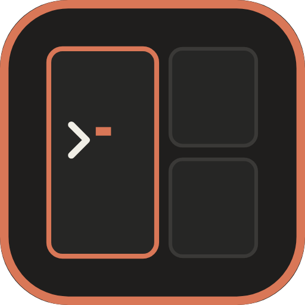

# ClaudeManager

A desktop manager for Claude Code sessions on Windows. A single full-screen
window acts as a compositor: hosting session tiles arranged in a tiling layout
or detached as floating windows, each with its own terminal and `claude` process.



## Features

- **Tiling and floating windows.** Tiles automatically split available space;
  the active tile can be detached, moved, and resized with the mouse.
- **Mouse reordering.** Each tile's header serves as a drag handle: drag it over
  another tile and release near an edge to tile alongside it, or in the center
  to swap the two. A preview highlights the target position before you release,
  and `Esc` cancels mid-drag. Dragging a floating tile to an edge snaps it back
  into the tiling layout.
- **Folder picker.** `Alt+N` opens fuzzy project search, a folder explorer, and
  a path input field, complete with badges for git branch, presence of
  `CLAUDE.md`, existing sessions, and folder trust status.
- **Session resuming.** Past conversations for a folder are listed with their
  labels and can be resumed with `--resume`.
- **Real-time status.** The indicator dot on each tile shows whether Claude is
  working or waiting for input, read directly from the session registry that
  Claude Code maintains in `~/.claude/sessions/`.
- **Usage statistics.** Tokens and list-price costs by day, model, and folder,
  calculated from session transcripts.
- **Layout restoration.** Reopening the app restores the exact tiling layout,
  resuming conversations right where they were left off.
- **Themes.** Six built-in themes (Claude Dark and Light, Midnight, Gruvbox,
  Nord, High Contrast) plus custom themes: simply drop a JSON file into
  `%APPDATA%\claudemanager\themes\`. Each theme defines both the UI and the 16
  terminal ANSI colors, and applies immediately to already open tiles.
- **Remote SSH sessions.** A tile can run Claude Code *on your remote server*:
  save connections, browse remote folders with the same badges as local ones,
  and resume existing conversations stored there. The remote folder is
  remembered for subsequent sessions.
- **Notifications when a session awaits input or finishes its turn.** With
  multiple tiles open, you cannot monitor them all: when a session starts
  waiting for a response, or finishes its turn, a system notification appears
  and the taskbar icon flashes. Clicking it takes you directly to that tile with
  the terminal focused. Each kind has its own switch in Settings.
- **Monitoring drawer.** A tab on the right edge slides out a panel showing
  daily costs, token usage, and context window fill percentage for each session.
  It can be detached into a standalone, always-on-top window and moved to another
  monitor.
- **Updates.** Both versions check for new releases. The installer downloads
  updates automatically and applies them on app shutdown—never unexpectedly
  while you are working; the portable build, which cannot self-replace, simply
  notifies you and provides a download link.

## Shortcuts

The modifier key is `Alt`. The compositor intercepts **only** the combinations
listed below: everything else reaches the terminal (and thus Claude) untouched.
On Italian keyboard layouts, `AltGr` emits `Ctrl+Alt` together, which is not
mapped, so `@`, `#`, `[`, `]`, `{`, `}` continue to work as expected.

| Key | Action |
| --- | --- |
| `Alt+N` | New session: opens the folder picker |
| `Alt+Enter` | New session in the active tile's folder |
| `Alt+B` / `Alt+V` | New session split side-by-side / stacked |
| `Alt+W` | Close active tile |
| `Alt+F` | Detach or re-dock active tile |
| `Alt+Z` | Maximize active tile to fill the screen |
| `Alt+←→↑↓` | Move focus |
| `Alt+Shift+←→↑↓` | Move tile within the layout |
| `Alt+1` … `Alt+9` | Jump to session N |
| `Alt+S` | Search active tile's scrollback buffer |
| `Alt+U` | Statistics panel |
| `Alt+,` | Settings |
| `F11` | Fullscreen |
| `Ctrl+Shift+Q` | Quit |

Every keybinding can be remapped in settings: click the row and press the
desired key combination. At least one modifier is required; otherwise, that
keystroke would stop reaching Claude. Custom bindings are saved to `config.json`
under `keymap` and **override** defaults: to unbind a shortcut without
replacing it—to return `Alt+B` to readline, for instance—assign it an empty
string.

Inside the picker: `↑↓` navigate, `Enter` opens, `Ctrl+Enter` enters folder,
`Tab` cycles between the three modes (Search, Explorer, Remote), `Ctrl+D` adds
to favorites, `Esc` cancels.

## Remote Sessions

In the folder picker, **Remote** mode lists saved servers. Adding one requires a
host address, username, and optionally a non-default port or private key path.
The **Test connection** button immediately checks reachability, remote OS, and
the installed Claude Code version.

Once a server is selected, you can browse its folders—with the same badges as
local directories (git repository, presence of `CLAUDE.md`)—and any existing
conversations **on that server** for the chosen directory appear below, ready to
be resumed just like local ones.

The tile executes `ssh -t` and starts `claude` in the remote folder. When the
session closes, it drops back to the local shell, allowing you to reconnect
without opening another tile.

**Authentication:** ClaudeManager never asks for or stores passwords. It relies
on standard SSH mechanics: keys in `~/.ssh` or an SSH agent. If the server is
not yet in your known hosts list, connect once manually with `ssh` to accept its
host key.

**What doesn't work remotely:** The status indicator dot and token statistics
rely on local files, whereas a remote session writes them to the remote server.
For this reason, a remote tile displays `remote` instead of `ready`/`working`:
pretending to know what Claude is doing would be guesswork. Resuming
conversations does work, however, as it queries the server on demand.

## Requirements

- Windows 10/11 x64
- [Claude Code](https://claude.com/claude-code) installed and accessible
  (`claude` in PATH, or `~/.local/bin/claude.exe`)
- For remote sessions: Windows OpenSSH client (Settings → Apps → Optional
  features) and Claude Code installed on the remote server

## Development

```powershell
npm install
npm run dev          # start with renderer hot reload
npm run typecheck    # typecheck main, preload, and renderer
npm test             # run test suite (see below)
npm run build        # build to out/
npm run dist         # generate NSIS installer and portable executable in release/
```

### Testing

```powershell
npm test             # run all tests
npm test -- fuzzy    # only test files whose name contains "fuzzy"
```

Tests live in `test/*.test.ts` and use Node's built-in test runner without any
additional test dependencies. Each file is bundled with esbuild before running:
this resolves the `@shared` alias and, crucially, replaces the `electron` module
(which does not exist in pure Node) with the stub in `test/helpers/electron.ts`.
Without this stub, most of the main process could not be tested outside
Electron, and validating edge cases would require launching the full application.

Bundling also provides an intentional benefit: each test file gets its own
isolated copy of modules, ensuring internal caches for configuration, folders,
and connections start fresh rather than polluting each other.

Most of the suite consists of **regression tests**: each cites the issue number
of the bug it prevents from recurring in a comment. The most critical test
passes a corpus of hostile arguments through real PowerShell and .NET,
verifying they arrive intact at the child process—on non-Windows platforms this
test automatically skips itself, as the bug it guards against cannot occur there.

### Releasing a Version

```powershell
npm run release -- minor --dry   # dry-run: preview changes without touching anything
npm run release -- minor         # bump version, write changelog, build, create tag
git push; git push origin v1.1.0
```

Build artifacts land in **`release/v<version>/`**, one directory per release.
Only files intended for publication stay in the root; `intermediate/` holds
`win-unpacked` and intermediate build artifacts. Alongside sits `TO-UPLOAD.md`,
listing exactly what to upload to GitHub and pre-filled with release notes
extracted from the changelog.

`npm run release -- --tidy` cleans up and organizes the current version directory
without bumping version numbers or git tags: useful after a manual `npm run dist`.

`npm run release -- --verify [<version>]` checks a release on GitHub: that it
is attached to the `v<version>` tag, that the tag points at the same commit as
the local one, and that `latest.yml` and the installer match. Run it before
publishing the draft and again after. Release 1.1.1 went live on a tag GitHub
made up, and nothing complained.

With `GH_TOKEN` set in your environment, the script also uploads release assets
to GitHub as a **draft**: it must be reviewed and published manually. As long
as it remains a draft, no clients receive it—by design, since auto-updates reach
every installed user, so making a release live must be an intentional decision
rather than the side effect of running a script.

Useful environment variables during development:

| Variable | Effect |
| --- | --- |
| `CM_WINDOWED=1` | Launch in windowed mode instead of fullscreen |
| `CM_DEV_BRIDGE=1` | Enable the development bridge (see below) |
| `CM_UPDATE_DEV=1` | Enable updates during development, reading `dev-app-update.yml` |
| `CM_DEVTOOLS=1` | Allow DevTools (F12) in a packaged build, to diagnose a problem on an installed copy. In development they are always on. |

`CM_UPDATE_DEV` exists because nobody notices a broken update pipeline until
release day. With a `dev-app-update.yml` pointing to a local feed, you can test
the entire update lifecycle—version comparison, downloading, sha512
verification—without publishing anything publicly.

### Development Bridge

With `CM_DEV_BRIDGE=1`, the app reads commands from
`%APPDATA%\claudemanager\dev-bridge\in.jsonl` (one JSON object per line),
allowing external automation and screenshot capture via Electron APIs without
stealing OS window focus or capturing other parts of the screen. This is used
for end-to-end tests. It is disabled by default and inert in production builds,
as the check on `app.isPackaged` precedes checking the environment variable.

Supported commands: `{"type":"key","key":"b","modifiers":["alt"]}`,
`{"type":"text","text":"..."}`, `{"type":"click","x":0,"y":0}`,
`{"type":"shot","path":"..."}`, `{"type":"eval","js":"...","path":"..."}`.

## Architecture

```
test/            regression suite, one file per subsystem
  helpers/       electron stubs, to run main process code in pure Node
src/
  main/          main process: owns PTYs and all filesystem access
    pty/         node-pty, PowerShell bootstrap script, env sanitization
    ssh/         ssh command generation, remote server queries
    claude/      paths, CLI arguments, transcripts, live session registry
    indexer/     index sources, fuzzy scoring, disk scanning
    usage/       token accounting and pricing tables
    store/       configuration, layout, favorites (atomic writes)
  preload/       sole surface exposed to renderer via contextBridge
  renderer/      compositor, picker, panels
    compositor/  layout tree, geometry, tiles
```

Design choices not immediately obvious from the code:

- **Tiles have their own IDs, distinct from PTY IDs.** A tile exists (and can be
  measured) before the process starts, so the PTY is spawned directly with the
  correct dimensions; moving a tile around the layout does not alter its React
  key, avoiding destroying its terminal buffer.
- **Sessions are tracked by `sessionId`, never by PID.** Under ConPTY,
  `node-pty` reports PID 0, and PIDs can be reused by the OS.
- **The environment passed to the PTY is sanitized.** If ClaudeManager is
  launched from inside a Claude Code terminal, `CLAUDE_CODE_CHILD_SESSION`
  would be inherited and disable transcript saving in all child sessions,
  breaking session resumption and statistics.
- **`claude` CLI arguments are passed via environment variables**, not via
  command-line arguments: this eliminates quoting and escaping bugs with Windows
  file paths.
- **Command lines are assembled by the application, not PowerShell.**
  PowerShell 5.1 constructs native executable command lines improperly: it does
  not escape embedded double quotes, does not double trailing backslashes, and
  decides whether to wrap an argument based on the *parity* of quotes
  encountered prior to a space. A prompt like `write a function "hello world"`
  would arrive split into two arguments with no error raised. `pty/winargs.ts`
  formats the line according to documented Windows C runtime rules, and the
  bootstrap passes it to `ProcessStartInfo.Arguments`, which leaves it
  untouched.
- **Electron's default application menu is removed.** It included `Ctrl+R`,
  which would reload the renderer and wipe out all terminal buffers.
- **Terminal measurement is frozen during layout animations.** Animating width
  and height triggers xterm's `ResizeObserver` on every frame: this would cause
  a dozen `pty.resize` events per transition, making Claude Code redraw each
  time. Content stays frozen while the frame animates, and is remeasured only
  once when the transition finishes.
- **Transitions are enabled only for layout changes.** When resizing the window
  or dragging tiles, tiles must stay locked directly beneath the cursor, not
  lag behind tracking animations.
- **`prefers-reduced-motion` is respected:** users who request reduced motion in
  OS settings only get color transitions without spatial animations.
- **A theme defines both the UI and the terminal together.** Keeping them
  separate could lead to glaring mismatches like a light UI frame surrounding a
  dark terminal. Incomplete themes are rejected with explicit error reasons
  rather than filled with fallback defaults: half-applied themes result in
  illegible combinations with no obvious cause.
- **Themes apply to existing open terminals dynamically.** xterm maintains its
  own copy of the color palette and does not read CSS, so it must be explicitly
  updated across every live terminal instance; new ones spawn with the active
  theme automatically.
- **The remote command uses single quotes exclusively, enforced by a check.**
  Between the app and the remote server's shell lie two layers of quoting, and
  PowerShell 5.1 cannot reliably deliver double quotes to native executables: it
  passes them unescaped, breaking the command line. As long as remote commands
  avoid double quotes the issue is avoided, but this invariant could easily be
  broken by careless edits, yielding syntax errors on the remote shell far
  removed from the root cause. Hence, `remoteCommand` raises an exception rather
  than emitting a brittle command.
- **Remote tiles still run through PowerShell**, which then launches `ssh`.
  Spawning `ssh` directly would be simpler, but if the connection dropped the
  tile would abruptly close; routing through PowerShell leaves an open local
  shell in the same folder, displaying why the session ended.
- **Remote server queries use plain POSIX shell scripts, without requiring `jq`
  or `python`.** The only tool guaranteed on any remote Unix machine is a POSIX
  shell. Remote conversation labels are parsed with `grep` from the tail of the
  transcript: while rough on ANSI escape sequences, it works out-of-the-box
  without requiring any dependencies installed on the server.
- **All server queries use `BatchMode=yes`.** Without it, ssh would hang
  waiting for password input that the user cannot see, freezing the UI; with it,
  ssh fails immediately on authentication problems, and the error is translated
  into an actionable message explaining what to do.
- **One release directory per version, with intermediate build files separated.**
  electron-builder places publishable artifacts and intermediate build files in
  the same folder—including a 300 MB `win-unpacked` directory and diagnostic
  logs. Manually distinguishing them when uploading assets to GitHub often leads
  to uploading the wrong file. The release script isolates publishable files and
  generates a step-by-step checklist, also verifying that the `sha512` checksum
  in `latest.yml` matches the installer: if it doesn't, auto-update downloads
  and discards the update silently.
- **Updates download automatically but do not install automatically.**
  Installing requires restarting the app, and an unexpected restart would kill
  all running Claude sessions. Updates are installed on app shutdown, or when
  explicitly triggered from the settings panel.
- **The portable executable checks for updates but does not auto-download.** A
  running `.exe` cannot replace itself on Windows, and the published auto-update
  file is the installer, which would inadvertently turn a portable instance into
  an installed one. Knowing a new version exists is still valuable, so update
  checks are performed and notifications provide a direct download link.
  Portable mode is detected via `PORTABLE_EXECUTABLE_DIR`, which electron-builder
  sets exclusively on portable targets.
- **Release notes cross the IPC boundary as plain text.** GitHub returns
  rendered HTML release notes: forwarding this raw HTML would expose the
  renderer to untrusted remote markup, risking XSS if rendered via
  `dangerouslySetInnerHTML`. The main process strips it down to plain text
  before sending it across IPC.
- **The version section sits at the top of settings**, because clicking the
  status bar version pill navigates directly there: placing it at the bottom
  would force users to scroll and search for what they just clicked.
- **Context window usage is measured by summing `input_tokens`, `cache_read`,
  and `cache_creation` from the latest turn.** `input_tokens` alone accounts
  only for non-cached tokens, which drops to near zero in long sessions: in a
  conversation using 68% context, `input_tokens` was just 2 tokens compared to
  683,052 cached tokens; relying solely on `input_tokens` would wrongly display
  ~0%.
- **The drawer shrinks the stage rather than overlaying it**, using margin
  rather than padding: the compositor measures bounding boxes, which padding
  does not reduce. Terminal measurements remain frozen throughout the drawer
  animation, just like layout changes.
- **The detached monitor window uses the same bundle with `#monitor` hash
  appended.** A second entry point would double build times and duplicate theme
  bootstrapping; using a URL hash does not alter the file path, so it functions
  identically in dev server and production `file://` modes. The detached window
  applies the theme independently: it lives in its own renderer process and
  inherits nothing from the main window.
- **Notifications fire on TRANSITION to "waiting for input", not continuously
  while waiting.** The session registry is rewritten frequently, and alerting
  on every disk write would spam notifications for a single wait state. Initial
  session discovery does not count as a transition: otherwise, launching the app
  would treat all active sessions as 'new' and fire a barrage of alerts for
  existing states.
- **A finished turn must stay finished for 1.5 seconds** (busy to idle) before
  it is announced, so a short idle between two steps of the same turn cannot
  trigger it. Several sessions finishing together produce one notification.
- **Only sessions belonging to a managed tile trigger notifications.** The
  registry contains every active Claude Code process on the machine, including
  those opened in external terminal windows; notifying for external sessions
  would be invasive.
- **A minimized window is treated as unobserved**, even if the OS still
  considers it focused/active: it is not visible on screen, so no one can see
  the status dot change color.
- **Panel subscribers are tracked by identity, not reference-counted.** A simple
  integer counter desynchronizes on edge cases—window closed without
  unregistering, renderer reloaded, crash—leaving a background timer running
  indefinitely polling transcripts every two seconds for nobody.

## Known Limitations

- If the app terminates abnormally (crash, `Stop-Process -Force`), tile shells
  may stay alive: process cleanup runs on `before-quit`, which is bypassed in
  such cases. A clean shutdown leaves no orphaned processes.
- Displayed costs reflect standard API list prices. For users with a Max or Pro
  subscription, this does not represent actual billed amounts, but rather the
  equivalent API cost for the same workload.
- Executables are not code-signed: on first launch, Windows SmartScreen will
  display an untrusted application prompt.
- Remote sessions lack real-time status dots and token counting: the registry
  and transcript files are located on the remote server.
- When opening a remote folder for the first time, Claude Code prompts to
  confirm trust for that folder, just like it does locally. You must respond
  directly inside the terminal tile.

## Roadmap

Planned fixes and features, with their order and milestones, are in
[ROADMAP.md](ROADMAP.md). Each item is tracked as a GitHub issue.

## License

MIT
